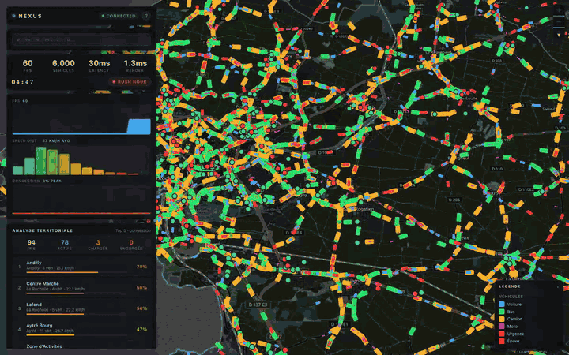
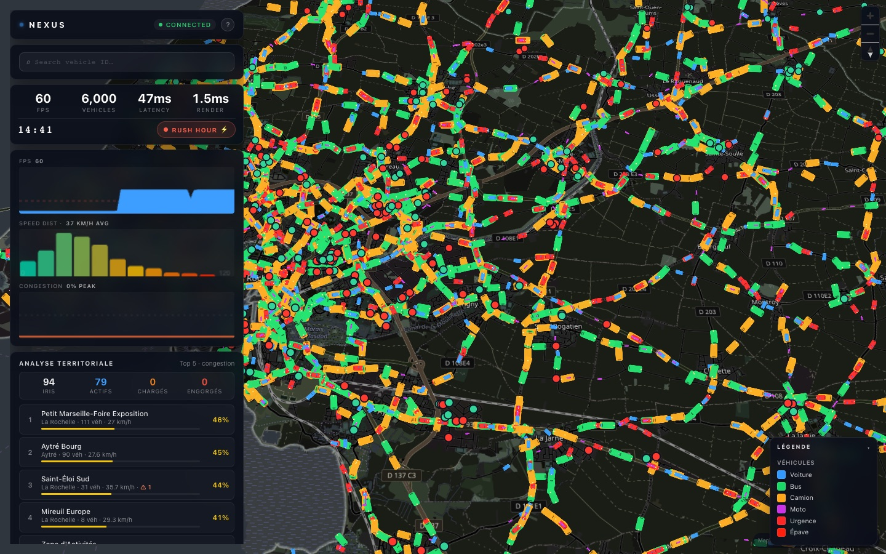
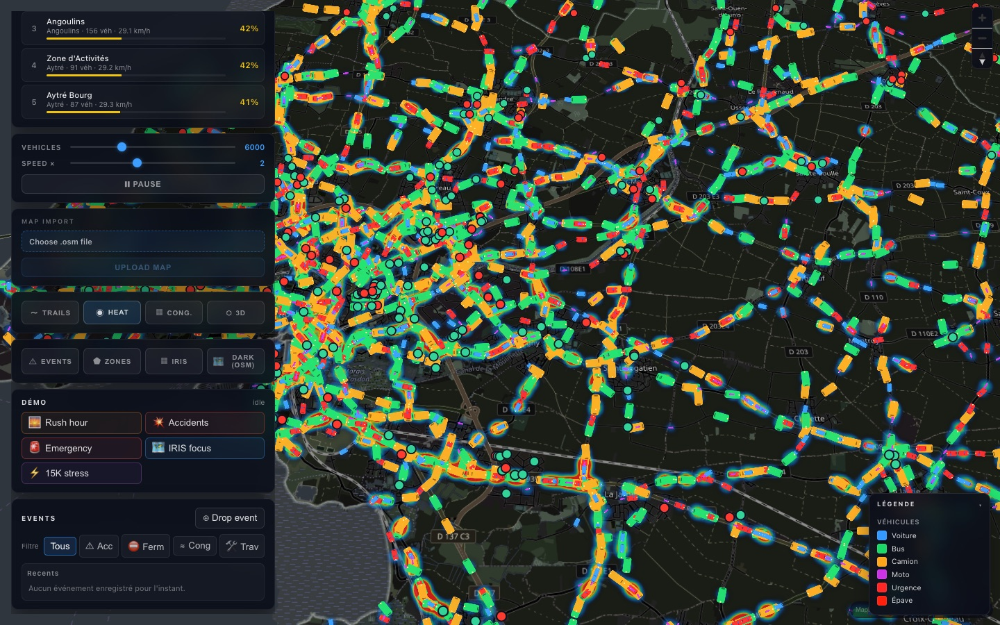
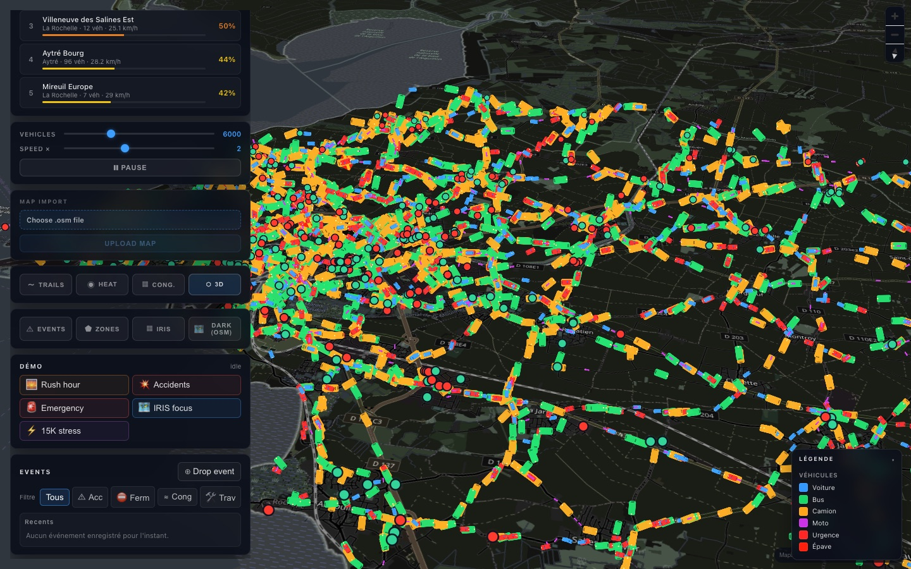
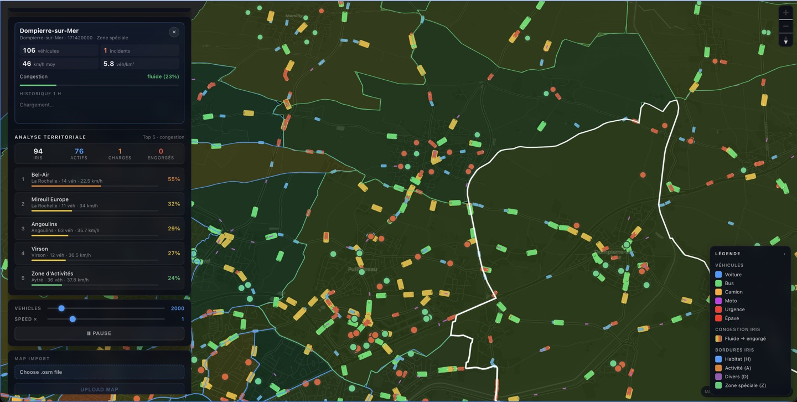
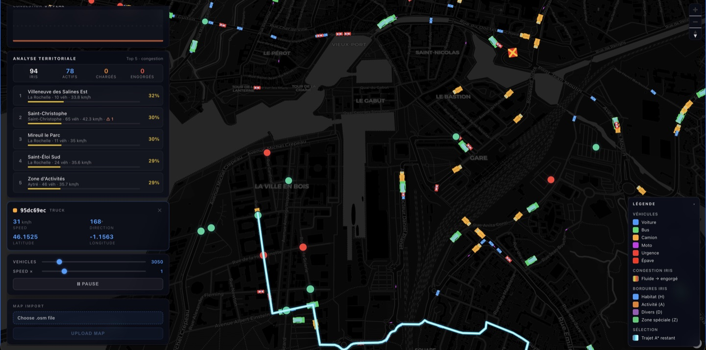
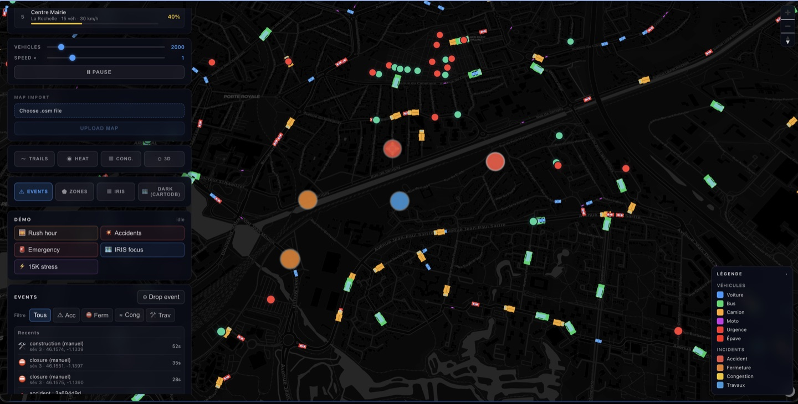

# NexusNexus

Real-time traffic visualisation and smart-city analytics platform.
Angular + WebGL frontend, Spring Boot backend, OpenStreetMap routing,
INSEE IRIS territorial analytics — handles 15 000+ moving vehicles
streamed over WebSocket with sub-100 ms latency.


<p align="center">
  
</p>

## What you can do with it

- **Watch a whole city move** — thousands of vehicles (cars, buses, trucks, motorbikes, emergency vehicles) drive on the real OpenStreetMap road network of La Rochelle, routed with A\* and rendered at 60 FPS in the browser.
- **Play with scenarios** — one-click *Rush hour*, *Accidents*, *Emergency*, *IRIS focus* and a *15K stress test*; drop incidents on the map and watch traffic re-route around them.
- **Read the city** — congestion and density heat-maps, a 3D tilted view, live speed distribution, and per-neighbourhood analytics from INSEE IRIS zones (top congested areas, vehicles per zone).
- **Inspect anything** — click a vehicle to follow it, replay the last 60 s, import another city's `.osm` map at runtime.

| Rush hour | Heat-map | 3D view |
|---|---|---|
|  |  |  |
| **IRIS territorial analytics** | **Vehicle inspector** | **Event feed** |
|  |  |  |

---

## Stack

| Layer    | Tech                                                                          |
| -------- | ----------------------------------------------------------------------------- |
| Frontend | Angular 17 (standalone components, signals), MapLibre GL JS, WebGL2, RxJS     |
| Backend  | Spring Boot 3, Java 21, Maven, WebSocket (STOMP/SockJS), Jackson              |
| Data     | OpenStreetMap (`.osm` files), INSEE IRIS (GeoJSON / IGN Géoplateforme WFS)    |
| Render   | WebGL2 instanced directional vehicle glyphs — single `drawArraysInstanced` per frame, 20 K cap |

---

## Repo layout

```
.
├── backend/                Spring Boot service (REST + WebSocket)
│   ├── src/main/java/com/nexus/
│   ├── src/main/resources/application.yml
│   ├── data/maps/          → put your .osm here  (gitignored, see below)
│   └── data/iris/          → optional iris.geojson (gitignored, see below)
├── frontend/               Angular app
│   └── src/app/
└── README.md               you are here
```

---

## Prerequisites

- **Java 21** (`java -version`)
- **Maven 3.9+** (or the project's `./mvnw` wrapper)
- **Node 20+ / npm 10+** (`node -v`, `npm -v`)
- ~2 GB free RAM (300 MB OSM file → ~1 GB road graph in memory)

---

## First-time setup

### 1. Get the OSM data

The default city is **La Rochelle**. The `.osm` file is too large to commit
(300+ MB), so download it once and drop it in `backend/data/maps/`:

```bash
# Quick option — BBBike's free city extracts (no account needed)
curl -L -o backend/data/maps/la-rochelle.osm \
  "https://extract.bbbike.org/?city=La+Rochelle&format=osm.xml"

# Or use Geofabrik's department extract (Charente-Maritime)
curl -L -o /tmp/poitou-charentes-latest.osm.pbf \
  "https://download.geofabrik.de/europe/france/poitou-charentes-latest.osm.pbf"
# … then convert .pbf → .osm with osmconvert / osmium
```

Want a different city? Drop any `.osm` / `.osm.xml` in `backend/data/maps/`
and either change `nexus.simulation.local-file` in `application.yml`, or
import it at runtime from the dashboard's **Map Import** panel.

### 2. (Optional) IRIS GeoJSON for offline analytics

The IRIS overlay tries a local file first, then IGN's WFS as fallback. For
reliable offline behaviour, download once:

- [Géoservices IGN — Contours IRIS](https://geoservices.ign.fr/contoursiris) (full France)
- [data.gouv.fr — Contours IRIS INSEE](https://www.data.gouv.fr/fr/datasets/contours-iris-de-linsee/) (per-department)

Drop it at `backend/data/iris/iris.geojson`. The loader accepts both the
official IGN field names (`CODE_IRIS`, `NOM_IRIS`) and the lower-case variants
from data.gouv (`code_iris`, `nom_iris`) — no renaming needed.

### 3. Backend

```bash
cd backend
./mvnw spring-boot:run        # or: mvn spring-boot:run
```

Watch for these startup lines:

- `Local OSM road graph loaded from la-rochelle.osm: 87 K nodes, 169 K edges`
- `TrafficLightSystem ready — 350 signals`
- `Loaded N IRIS zones from local file` *or* `from IGN WFS`
- `SimulationEngine ready — 2000 vehicles`

Backend listens on **http://localhost:8080**.

### 4. Frontend

```bash
cd frontend
npm install
npm start
```

Frontend on **http://localhost:4200**. WebSocket auto-connects to the backend;
the dashboard fills with live vehicles within ~1 s.

---

## Key endpoints

| Endpoint                                          | Purpose                              |
| ------------------------------------------------- | ------------------------------------ |
| `GET  /api/simulation/status`                     | Fleet size, paused state, counts     |
| `GET  /api/simulation/lights`                     | All traffic-light positions + state  |
| `GET  /api/simulation/events`                     | Live incidents (wrecks + manual)     |
| `POST /api/simulation/incidents`                  | Drop a manual incident               |
| `GET  /api/simulation/incidents/history`          | Last 50 manual incidents             |
| `GET  /api/simulation/zones`                      | Geofence polygons + live counts      |
| `POST /api/simulation/vehicles?count=N`           | Resize the fleet (1–20 000)          |
| `POST /api/simulation/speed?multiplier=N`         | Speed factor (0–5×)                  |
| `POST /api/simulation/traffic/override?mode=…`    | `NORMAL` / `RUSH_HOUR` / `NIGHT`     |
| `GET  /api/iris/zones`                            | Full GeoJSON FeatureCollection       |
| `GET  /api/iris/counts`                           | Lightweight per-zone counts          |
| `GET  /api/iris/top-congested?limit=N`            | Worst-N zones by congestion score    |
| `POST /api/iris/reload`                           | Re-fetch IRIS (file then WFS)        |
| `POST /api/map/import` (multipart)                | Hot-swap the road graph              |
| `WS   /ws` (STOMP, topic `/topic/vehicles`)       | 10 Hz vehicle frames (delta-encoded) |

---

## Performance design

- **Delta WebSocket** — only changed vehicles each tick, full keyframe every 2 s. Cuts payload ~5× vs. full snapshots.
- **rAF coalesce** — client applies deltas synchronously, downstream render batched per browser frame so SockJS backlog can't accumulate.
- **A\* route cache + hot-edge avoidance** — paths memoised with a 5 s TTL; congested edges get a 2.5× cost penalty so vehicles route around jams. Hot-edge set rebuilt at 1 Hz.
- **Adaptive sampling** — at city-wide zoom we sample 1 : N vehicles to the renderer; sub-pixel at that scale, no visual difference.
- **Directional vehicle shader** — the fragment shader tapers each marker into a heading-aware glyph with a brighter nose and selected halo, without adding DOM or extra geometry.
- **Congestion flow legend** — the dashboard shows a compact green→yellow→red ramp when the congestion overlay is enabled.
- **Bbox + ray-cast geofence containment** — at 15 K vehicles × 250 IRIS polygons, the bbox prefilter rejects ~95 % of pairs in 4 compares.
- **Lazy A\* + per-tick budget** — vehicles spawn with a minimal 2-node path; full A\* runs lazily, capped at 400 searches per tick to prevent spikes.
- **WebGL2 instanced rendering** — single `drawArraysInstanced` per frame, 20 K instance slots in DYNAMIC_DRAW buffer.
- **Compact wire format** — lat/lon rounded to 5 dp (~1 m), speed to 1 dp, direction to int; `wrecked: false` omitted.


---

## Configuration

Most settings live in `backend/src/main/resources/application.yml`:

```yaml
nexus:
  simulation:
    vehicle-count: 2000      # initial fleet size
    update-rate-ms: 100      # server tick + broadcast interval (10 Hz)
    max-vehicles: 20000      # hard cap
    graph-source: local-file # local-file | overpass
    local-file: data/maps/la-rochelle.osm
    iris-local-file: data/iris/iris.geojson
```

---

## Project status

Actively developed as a Master's project (M2 Informatique et Mobilité, Université de Haute-Alsace).
Base map: OpenStreetMap tiles, darkened on the GPU with MapLibre raster paint properties (no API key needed).

---

## License

[MIT](LICENSE) © 2026 Meryem Belmouaddine. Map data © OpenStreetMap contributors, IRIS data © INSEE / IGN.
